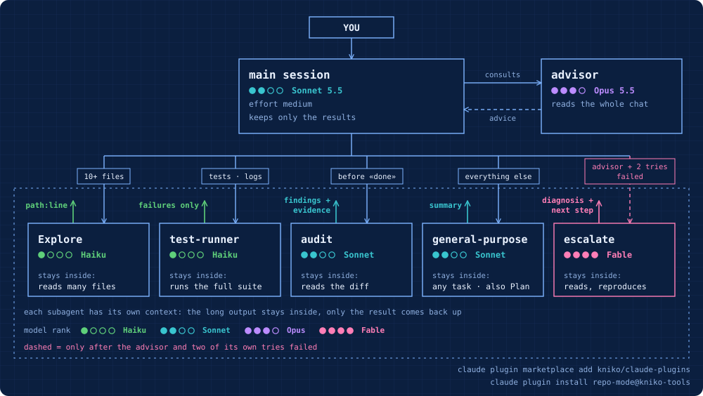
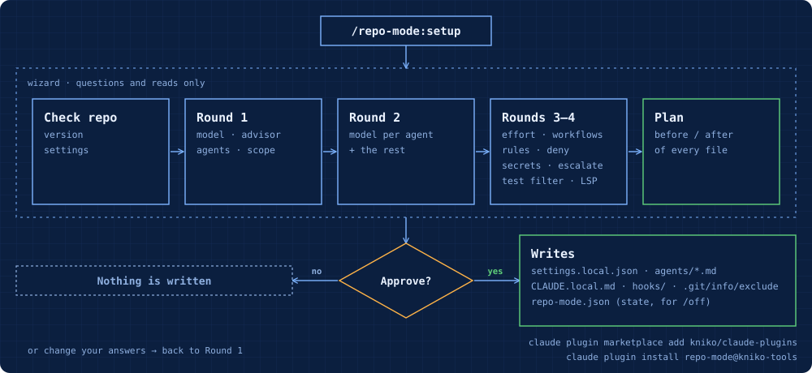

# repo-mode

[Ελληνικά](README.md) · **English**

A Claude Code wizard that decides, **per repository**, which model does which job: the main model and its effort, the advisor, helper subagents on cheaper models, delegation rules, Read deny rules and a code-intelligence plugin. It writes nothing until you approve the full plan, and `/repo-mode:off` undoes exactly what it wrote.

## Install

In a terminal (once, for every repo):

```bash
claude plugin marketplace add kniko/claude-plugins
claude plugin install repo-mode@kniko-tools
```

Then start a new Claude Code session and run `/repo-mode:setup` inside the repo you want to configure.

| I want to… | Command |
|---|---|
| update to a newer version | `claude plugin marketplace update kniko-tools`, then `claude plugin update repo-mode@kniko-tools` |
| check it is installed | `claude plugin list` (should show `repo-mode@kniko-tools`) |
| remove it | first `/repo-mode:off` in every repo where you ran setup, then `claude plugin uninstall repo-mode@kniko-tools` |

If you installed an older copy from a zip or a local folder (`repo-mode@local-tools`), remove it first:

```bash
claude plugin uninstall repo-mode@local-tools
claude plugin marketplace remove local-tools
```

The plugin installs at user scope, so its commands are available in every repo. On its own it changes nothing in any repo: only `/repo-mode:setup` makes changes, and only in the repo where you run it.

## Why it's worth it

Out of the box, Claude Code runs almost everything on the same model, usually the most expensive one. repo-mode splits the work along the lines of Anthropic's docs and guidance:

| Without repo-mode | With repo-mode | Benefit |
|---|---|---|
| The built-in **Explore** subagent runs on **Opus** with a Claude subscription or Console account. | A repo-level `Explore` agent replaces it, on **Haiku** with `effort: low`. | Code search is the most frequent subagent job. Haiku 5.5 costs $0.10 / $0.50 per million tokens (input / output) for prompts up to 100K tokens; `autoCompactWindow: 100000` keeps it under that line. |
| **general-purpose**, **Plan** and **workflow** agents inherit the main session's model. With an Opus main model, they run on Opus too. | `CLAUDE_CODE_SUBAGENT_MODEL` (e.g. `sonnet`) is set for this repo only. | Other subagents and workflow agents move off the expensive model without touching the main session. A workflow script that names its own model for a stage still keeps it. |
| A dynamic workflow can launch many agents. | `workflowSizeGuideline` per repo (e.g. `small`). | Claude aims for fewer agents when it writes a workflow. It is guidance, not a hard cap. |
| One model does both planning and execution. | Sonnet (or Haiku) main model with an **Opus advisor**, or `opusplan`. | The advisor reads the conversation only at decision points. In Anthropic's blog, Sonnet with an Opus advisor scored +2.7 points on SWE-bench Multilingual at 11.9% lower cost per task, and Haiku with an Opus advisor scored 41.2% vs 19.7% solo on BrowseComp (measured on earlier models). |
| A subagent on a different model from the main session doesn't get the session's effort level. | Each template sets `effort`: `low` for search and tests, `high` for review. | Less thinking spent on mechanical work, more on review. |
| Full test runs and logs flood the main context. | **test-runner** returns only the failures, verbatim. | The noise stays out; only the summary reaches the main session. |
| Every `pytest`, `npm test` or `go test` brings its whole output into context, even when everything passes. | Optional **test-output filter** (PreToolUse hook): Claude sees only the failures and the last 20 lines. The exit code stays real and the full output is saved to a temp file. | Fewer tokens on **every** test run, in the main session too. Based on the docs example, improved so the exit code isn't lost. |
| The session that wrote the code also reviews it. | **audit** reviews the diff independently, without the conversation history and without style comments. | A fresh reviewer hasn't seen the reasoning behind the code, so it isn't swayed by it. |
| The advisor takes one model, and the hardest problems may need a stronger one. | Optional read-only **escalate** subagent on Fable, plus a rule: call it only after the advisor and two own attempts failed. | The expensive model is used only when stuck, not for every turn. The main session must brief it; it doesn't see the conversation, and each call is billed at Fable prices. |
| `--continue` or `--resume` on a long conversation re-reads the whole history, uncached, on the first message. | `/repo-mode:handoff` writes a short `HANDOFF.md`; the next session starts fresh and reads only that. | A small context instead of the whole old one. |
| Claude can read `.env` files and SSH keys. | Optional Read deny rules for `.env`, `~/.ssh` and `secrets/`. | Safety, not cost. It stops Claude's file tools and recognized file commands such as `cat`, not scripts that open files themselves. |
| Claude guesses when to delegate, and can keep retrying fixes forever. | Short rules in `CLAUDE.local.md`. Optional: stop a fix loop after two rounds without progress. | Delegation only when it pays. Anthropic estimates multi-agent setups use 3–10× more tokens, so delegating makes sense only for 10+ files, 3+ independent pieces of work, or an independent check. |
| Vendored or generated code shows up in searches. | Read deny rules, only for tracked folders such as `vendor/` and `dist/`. | Fewer useless files in context. |

To see where tokens go, `/usage` shows consumption per subagent.

## How the work is split



Each subagent starts with its own clean context, without CLAUDE.md (`omitClaudeMd: true`) and without the Agent tool, so it can't start subagents of its own. Only its final message returns to the main session. Subagents don't give a smarter answer than the main session; they help with three things: parallel work, keeping noise out of the context, and independent checking.

## How the setup is created



At the approval step you can also change your answers: the wizard goes back to Round 1. A model/advisor pair that isn't allowed is asked again in the same round. With the "Whole team" scope the files are `.claude/settings.json` and `CLAUDE.md`, for committing.

## Commands

| Command | What it does |
|---|---|
| `/repo-mode:setup` | Asks for main model, advisor, subagents, scope, subagent models, the model for other subagents and workflows, effort, workflow size, rules, deny rules, test-output filter and LSP. Shows every change (before/after) and applies only after you approve. |
| `/repo-mode:status` | Read-only: what applies in this repo right now and which file it comes from. Also flags costly setups, e.g. subagents running on Opus. |
| `/repo-mode:handoff` | Writes `HANDOFF.md` (goal, state, next steps, decisions) so the next session starts fresh. Cheaper than resuming a long conversation, which re-reads the whole history uncached. Writes only that file. |
| `/repo-mode:off` | Undoes exactly what setup wrote (from `.claude/repo-mode.json`), restores the previous values, and asks for approval before deleting anything. |

After `setup` or `off`, start a new session in the repo.

## Recommended choices

| Question | Recommendation | Alternatives |
|---|---|---|
| Main model | Sonnet | Opus · `opusplan` (Opus in plan mode, Sonnet for execution) · Haiku (cheapest, good with an Opus advisor) |
| Advisor | Opus | Fable · Sonnet (not with an Opus main model) · none |
| Explore / test-runner | Haiku | Sonnet · same as main |
| audit | Sonnet | Opus · same as main |
| escalate | Fable | Opus |
| Other subagents and workflow agents | Sonnet if the main model is Opus, `opusplan` or Fable; otherwise same as main | Haiku |
| Effort | model default (`medium`) | `high` / `xhigh` for hard work, `low` for routine work |
| Workflow size | default (`medium`, or `small` on Pro) | `small` to save · `large` / `unrestricted` for big refactors |
| Delegation rules | Yes | Yes + stop fix loops · No |
| Test-output filter | Yes: Bash tool (needs `bash` and `jq`), PowerShell tool (needs `pwsh` or Windows PowerShell), or both | No |

## What it writes in each repo

**"Only me" scope (default)**: nothing is committed.
- `.claude/settings.local.json`: `model`, `advisorModel`, `effortLevel`, `workflowSizeGuideline`, `env.CLAUDE_CODE_SUBAGENT_MODEL`, `permissions.deny`, `hooks.PreToolUse` (the test filter)
- `.claude/agents/Explore.md`, `test-runner.md`, `audit.md`, `escalate.md` (whichever you pick)
- `.claude/hooks/repo-mode-filter-tests.sh` (Bash) and/or `repo-mode-filter-tests.ps1` (PowerShell): the test-filter script, if you pick it
- `CLAUDE.local.md`: a block of delegation rules between `<!-- repo-mode:start/end -->`
- `.claude/repo-mode.json`: what changed, so undo is exact
- `.git/info/exclude`: all of the above, so they don't show in `git status` (the repo's `.gitignore` is untouched)

**"Whole team" scope**: the same, but in `.claude/settings.json` and `CLAUDE.md`, for committing.

## Notes

- **Ultracode:** repo-mode never turns it on. With ultracode, Claude writes a workflow for every substantive task at `xhigh` effort, and the docs say each request uses more tokens and takes longer. Turn it on only for a big task with `/effort ultracode`, and off again with `/effort ultracode off`. Workflow agents without a model of their own then use the one repo-mode set.
- **Test filter:** it only catches plain test commands, with no `;`, `|`, `&&` etc. Every other command passes through unchanged. Without `jq` (Bash variant) or `pwsh`/`powershell.exe` (PowerShell variant) it does nothing. The command that actually runs is the wrapped one, so an allow rule like `Bash(pytest *)` no longer matches and Claude may ask for approval. The PowerShell variant is for the separate PowerShell tool (a preview in the docs; opt-in on WSL/Linux/macOS with `CLAUDE_CODE_USE_POWERSHELL_TOOL=1`). It was tested with `pwsh` 7 and Windows PowerShell 5.1, not yet in a live Windows session. `/hooks` shows whether it's active.
- The advisor is experimental and works only through the Anthropic API, not Bedrock, Vertex or Foundry. It doesn't work if `DISABLE_TELEMETRY` is set. Each call re-reads the whole conversation, uncached, at the advisor model's rates. It pays off on long multi-step work, not on short tasks.
- Don't change the advisor from the `/advisor` picker: it saves to your global settings and applies to every repo.
- `audit` does similar work to the built-in `/code-review`. `audit` runs automatically before "done"; `/code-review` runs whenever you call it.
- The `audit` agent doesn't run in a worktree: a worktree starts from the default branch without your uncommitted changes, so it wouldn't see the diff.
- `audit` and `test-runner` have Bash. That they don't change files is stated in their instructions, not enforced by Claude Code. `Explore` is technically read-only (Read, Grep, Glob only).
- Minimum Claude Code versions: `autoCompactWindow` v2.1.296+, Haiku 5.5 v2.1.293+, Sonnet 5.5 v2.1.284+, Opus 5.5 v2.1.280+, `omitClaudeMd` v2.1.271+. Older versions simply ignore fields they don't know.

## Sources

- [Create custom subagents](https://code.claude.com/docs/en/sub-agents)
- [Advisor](https://code.claude.com/docs/en/advisor)
- [Model configuration](https://code.claude.com/docs/en/model-config)
- [Manage costs](https://code.claude.com/docs/en/costs)
- [Best practices](https://code.claude.com/docs/en/best-practices)
- [Pricing](https://platform.claude.com/docs/en/about-claude/pricing)
- [How and when to use subagents in Claude Code](https://claude.com/resources/articles/subagents-in-claude-code)
- [Steering Claude Code](https://claude.com/resources/articles/steering-claude-code-skills-hooks-rules-subagents-and-more)
- [The advisor strategy](https://claude.com/blog/the-advisor-strategy)
- [When to use multi-agent systems](https://claude.com/blog/building-multi-agent-systems-when-and-how-to-use-them)
- [Dynamic workflows](https://code.claude.com/docs/en/workflows)

Facts checked on 2026-11-08 (workflows: 2026-11-09).
