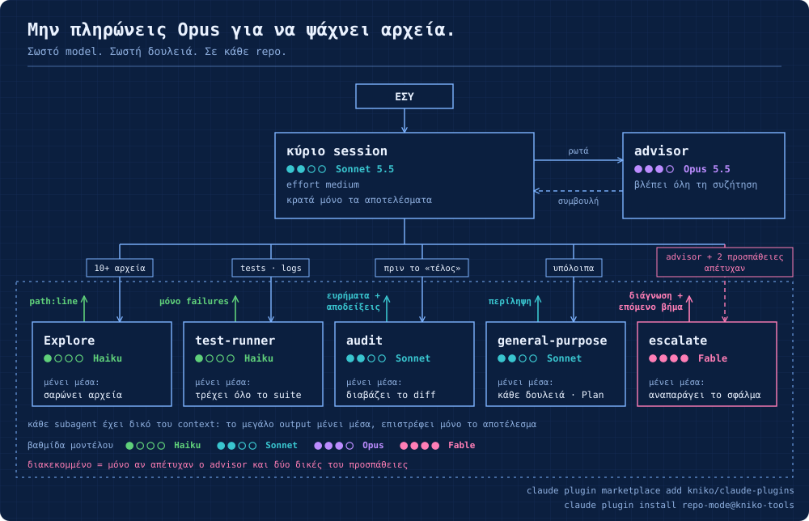
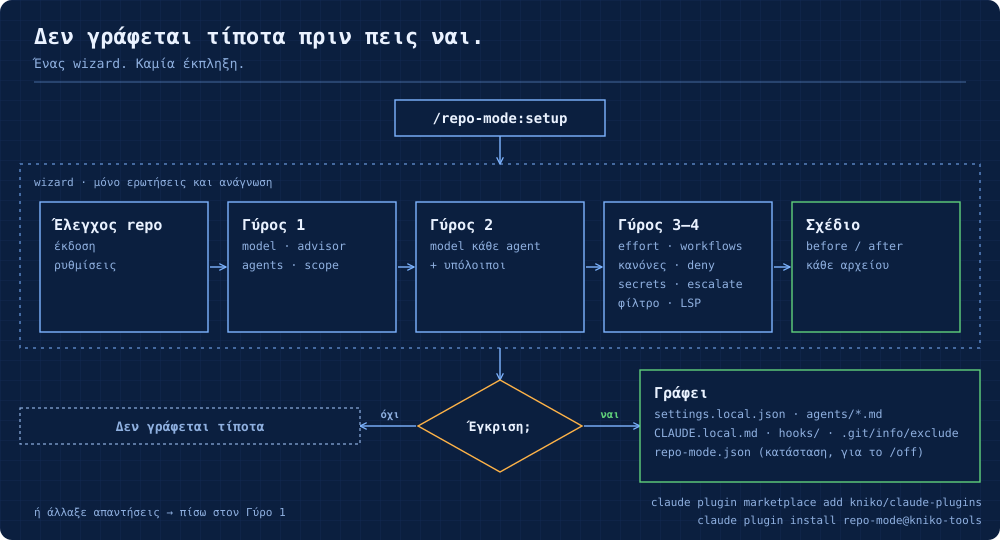

# repo-mode

**Ελληνικά** · [English](README.en.md)

Οδηγός (wizard) για Claude Code που ρυθμίζει **ανά repository** ποιο model κάνει ποια δουλειά: το κύριο model και το effort του, τον advisor, βοηθητικούς subagents με φθηνότερα models, κανόνες ανάθεσης, Read deny rules και code-intelligence plugin. Δεν γράφει τίποτα πριν εγκρίνεις ολόκληρο το σχέδιο, και το `/repo-mode:off` αναιρεί ακριβώς ό,τι έγραψε.

## Εγκατάσταση

Στο terminal (μία φορά, για όλα τα repos):

```bash
claude plugin marketplace add kniko/claude-plugins
claude plugin install repo-mode@kniko-tools
```

Μετά ξεκίνα νέο session Claude Code και τρέξε `/repo-mode:setup` μέσα στο repo που θέλεις να ρυθμίσεις.

| Θέλω να… | Εντολή |
|---|---|
| πάρω νεότερη έκδοση | `claude plugin marketplace update kniko-tools` και μετά `claude plugin update repo-mode@kniko-tools` |
| δω αν είναι εγκατεστημένο | `claude plugin list` (πρέπει να δείχνει `repo-mode@kniko-tools`) |
| το αφαιρέσω | πρώτα `/repo-mode:off` σε κάθε repo όπου το έτρεξες, μετά `claude plugin uninstall repo-mode@kniko-tools` |

Αν το είχες εγκαταστήσει παλιότερα από zip ή τοπικό φάκελο (`repo-mode@local-tools`), αφαίρεσέ το πρώτα:

```bash
claude plugin uninstall repo-mode@local-tools
claude plugin marketplace remove local-tools
```

Το plugin μπαίνει σε user scope, άρα οι εντολές είναι διαθέσιμες σε κάθε repo. Από μόνο του δεν αλλάζει τίποτα σε κανένα repo: τις αλλαγές τις κάνει μόνο το `/repo-mode:setup`, και μόνο στο repo όπου το τρέχεις.

## Γιατί αξίζει

Χωρίς ρυθμίσεις, το Claude Code τρέχει σχεδόν όλη τη δουλειά στο ίδιο (συνήθως το ακριβότερο) model. Το repo-mode μοιράζει τη δουλειά με βάση τα docs και τις οδηγίες της Anthropic:

| Χωρίς repo-mode | Με repo-mode | Όφελος |
|---|---|---|
| Ο ενσωματωμένος **Explore** τρέχει σε **Opus** όταν έχεις συνδρομή ή Console account. | Ένας agent `Explore` του repo τον αντικαθιστά, σε **Haiku**, με `effort: low`. | Η αναζήτηση στον κώδικα είναι η πιο συχνή δουλειά subagent. Το Haiku 5.5 κοστίζει $0.10 / $0.50 ανά εκατομμύριο tokens (input / output) μέχρι τα 100K tokens prompt. Το `autoCompactWindow: 100000` τον κρατά κάτω από αυτό το όριο. |
| Οι **general-purpose**, **Plan** και οι agents των **workflows** παίρνουν το model του κύριου session. Με κύριο Opus, τρέχουν κι αυτοί σε Opus. | Το `CLAUDE_CODE_SUBAGENT_MODEL` (π.χ. `sonnet`) μπαίνει μόνο σε αυτό το repo. | Οι υπόλοιποι subagents και οι workflow agents φεύγουν από το ακριβό model, χωρίς να αλλάζει το κύριο session. Ένα workflow script που ορίζει δικό του model για κάποιο στάδιο εξακολουθεί να το κρατάει. |
| Ένα dynamic workflow μπορεί να ξεκινήσει πολλούς agents. | `workflowSizeGuideline` ανά repo (π.χ. `small`). | Το Claude στοχεύει σε λιγότερους agents όταν γράφει workflow. Είναι οδηγία, όχι αυστηρό όριο. |
| Ένα model κάνει και τον σχεδιασμό και την εκτέλεση. | Κύριο Sonnet (ή Haiku) με **Opus advisor**, ή `opusplan`. | Ο advisor διαβάζει τη συζήτηση μόνο στα σημεία απόφασης. Στο blog της Anthropic, Sonnet με Opus advisor έδωσε +2.7 μονάδες στο SWE-bench Multilingual με 11.9% χαμηλότερο κόστος ανά task, και Haiku με Opus advisor 41.2% αντί για 19.7% στο BrowseComp (μετρήσεις με παλαιότερα models). |
| Ένας subagent σε άλλο model από το κύριο δεν παίρνει το effort του session. | Κάθε template ορίζει `effort`: `low` για αναζήτηση και tests, `high` για review. | Λιγότερο «σκέψιμο» στις μηχανικές δουλειές, περισσότερο στο review. |
| Τα πλήρη tests και τα logs γεμίζουν το κύριο context. | Ο **test-runner** επιστρέφει μόνο τα failures, αυτολεξεί. | Ο θόρυβος μένει έξω. Στο κύριο session φτάνει μόνο η σύνοψη. |
| Κάθε `pytest`, `npm test` ή `go test` φέρνει όλη την έξοδο μέσα στο context, ακόμα και όταν όλα περνούν. | Προαιρετικό **φίλτρο εξόδου tests** (PreToolUse hook): το Claude βλέπει μόνο τα failures και τις τελευταίες 20 γραμμές. Το exit code μένει το πραγματικό και η πλήρης έξοδος σώζεται σε προσωρινό αρχείο. | Λιγότερα tokens σε **κάθε** εκτέλεση tests, και στο κύριο session. Βασίζεται στο παράδειγμα των docs, βελτιωμένο ώστε να μη χάνεται το exit code. |
| Το review το κάνει το ίδιο session που έγραψε τον κώδικα. | Ο **audit** κάνει ανεξάρτητο review του diff, χωρίς το ιστορικό της συζήτησης και χωρίς σχόλια για στυλ. | Ένας «φρέσκος» reviewer δεν έχει δει το σκεπτικό του κώδικα, άρα δεν επηρεάζεται από αυτό. |
| Ο advisor παίρνει ένα μόνο model και τα δυσκολότερα προβλήματα ίσως θέλουν δυνατότερο. | Προαιρετικός subagent **escalate** (μόνο ανάγνωση) σε Fable, και κανόνας: κάλεσέ τον μόνο αν ο advisor και δύο δικές σου προσπάθειες απέτυχαν. | Το ακριβό model χρησιμοποιείται μόνο όταν κολλήσεις, όχι σε κάθε turn. Το κύριο session πρέπει να τον ενημερώσει· δεν βλέπει τη συζήτηση και κάθε κλήση χρεώνεται σε τιμή Fable. |
| Το `--continue` ή `--resume` σε μεγάλη συζήτηση ξαναδιαβάζει όλο το ιστορικό, χωρίς cache, στο πρώτο μήνυμα. | Το `/repo-mode:handoff` γράφει ένα μικρό `HANDOFF.md`· το επόμενο session ξεκινά καθαρά και διαβάζει μόνο αυτό. | Μικρό context αντί για ολόκληρο το παλιό. |
| Το Claude μπορεί να διαβάσει αρχεία `.env` και κλειδιά SSH. | Προαιρετικοί Read deny κανόνες για `.env`, `~/.ssh` και `secrets/`. | Ασφάλεια, όχι κόστος. Σταματά τα file tools του Claude και αναγνωρισμένες εντολές όπως `cat`, όχι scripts που ανοίγουν μόνα τους αρχεία. |
| Το Claude μαντεύει πότε να αναθέσει, και μπορεί να επαναλαμβάνει διορθώσεις χωρίς τέλος. | Σύντομοι κανόνες στο `CLAUDE.local.md`. Προαιρετικά: σταμάτα έναν κύκλο διορθώσεων μετά από δύο γύρους χωρίς πρόοδο. | Ανάθεση μόνο όταν συμφέρει. Η Anthropic εκτιμά ότι τα συστήματα με πολλούς agents καίνε 3–10× περισσότερα tokens, άρα η ανάθεση έχει νόημα μόνο για 10+ αρχεία, 3+ ανεξάρτητα κομμάτια, ή ανεξάρτητο έλεγχο. |
| Vendored ή generated κώδικας μπαίνει στις αναζητήσεις. | Read deny rules μόνο για tracked φακέλους, όπως `vendor/` και `dist/`. | Λιγότερα άχρηστα αρχεία στο context. |

Για να δεις πού πάνε τα tokens, το `/usage` δείχνει την κατανάλωση ανά subagent.

## Πώς μοιράζεται η δουλειά



Κάθε subagent ξεκινά με δικό του, καθαρό context, χωρίς CLAUDE.md (`omitClaudeMd: true`) και χωρίς το Agent tool, άρα δεν ξεκινά δικούς του subagents. Στο κύριο session επιστρέφει μόνο το τελικό του μήνυμα. Οι subagents δεν δίνουν «εξυπνότερη» απάντηση από το κύριο session. Βοηθούν σε τρία πράγματα: παράλληλη δουλειά, θόρυβο έξω από το context, ανεξάρτητο έλεγχο.

## Πώς δημιουργούνται οι ρυθμίσεις



Στην έγκριση μπορείς και να αλλάξεις απαντήσεις: ο wizard γυρίζει στον Γύρο 1. Μη επιτρεπτός συνδυασμός model/advisor ξαναρωτιέται στον ίδιο γύρο. Στο scope «Όλη η ομάδα» τα αρχεία είναι `.claude/settings.json` και `CLAUDE.md`, για commit.

## Εντολές

| Εντολή | Τι κάνει |
|---|---|
| `/repo-mode:setup` | Ρωτάει main model, advisor, subagents, scope, models των subagents, model για τους υπόλοιπους subagents και τα workflows, effort, μέγεθος workflows, κανόνες, deny rules, φίλτρο εξόδου tests και LSP. Δείχνει όλες τις αλλαγές (before/after) και εφαρμόζει μόνο μετά την έγκρισή σου. |
| `/repo-mode:status` | Μόνο ανάγνωση: τι ισχύει τώρα σε αυτό το repo και από ποιο αρχείο προέρχεται. Επισημαίνει και ακριβές ρυθμίσεις, π.χ. subagents που τρέχουν σε Opus. |
| `/repo-mode:handoff` | Γράφει το `HANDOFF.md` (στόχος, κατάσταση, επόμενα βήματα, αποφάσεις) ώστε το επόμενο session να ξεκινά καθαρά. Φθηνότερο από resume σε μεγάλη συζήτηση, που ξαναδιαβάζει όλο το ιστορικό χωρίς cache. Γράφει μόνο αυτό το αρχείο. |
| `/repo-mode:off` | Αναιρεί ακριβώς ό,τι έγραψε το setup (από το `.claude/repo-mode.json`), επαναφέρει τις προηγούμενες τιμές, και ζητάει έγκριση πριν σβήσει οτιδήποτε. |

Μετά από `setup` ή `off`, ξεκίνα νέο session στο repo.

## Προτεινόμενες επιλογές

| Ερώτηση | Πρόταση | Εναλλακτικές |
|---|---|---|
| Κύριο model | Sonnet | Opus · `opusplan` (Opus στο plan mode, Sonnet στην εκτέλεση) · Haiku (το φθηνότερο, καλό με Opus advisor) |
| Advisor | Opus | Fable · Sonnet (όχι με κύριο Opus) · κανένας |
| Explore / test-runner | Haiku | Sonnet · ίδιο με το κύριο |
| audit | Sonnet | Opus · ίδιο με το κύριο |
| escalate | Fable | Opus |
| Υπόλοιποι subagents και workflow agents | Sonnet αν το κύριο είναι Opus, `opusplan` ή Fable. Αλλιώς ίδιο με το κύριο. | Haiku |
| Effort | default του model (`medium`) | `high` / `xhigh` για δύσκολη δουλειά, `low` για ρουτίνα |
| Μέγεθος workflows | default (`medium`, ή `small` σε Pro) | `small` για οικονομία · `large` / `unrestricted` για μεγάλα refactors |
| Κανόνες ανάθεσης | Ναι | Ναι + σταμάτημα κύκλων διορθώσεων · Όχι |
| Φίλτρο εξόδου tests | Ναι: Bash tool (θέλει `bash` και `jq`), PowerShell tool (θέλει `pwsh` ή Windows PowerShell) ή και τα δύο | Όχι |

### Γιατί Sonnet ως κύριο model, και όχι Fable

Το Sonnet είναι έγκυρο κύριο model και αυτό που προτείνει το repo-mode, με Opus advisor. Το σκεπτικό:

- **Το κύριο model είναι η πιο ακριβή θέση.** Παίρνει κάθε turn και ξαναδιαβάζει όλη τη συζήτηση κάθε φορά, άρα η τιμή του πολλαπλασιάζεται σε όλο το session. Οι βοηθοί βλέπουν μόνο το δικό τους μικρό context.
- **Το ποιος παίρνει ποια δουλειά είναι το εύκολο κομμάτι.** Οι κανόνες ανάθεσης στο `CLAUDE.local.md` λένε ήδη πότε πάει δουλειά στους Explore, test-runner και audit. Αυτό δεν χρειάζεται το δυνατότερο model.
- **Με κύριο model Fable περιορίζεται ο advisor.** Στον πίνακα ζευγαριών των docs, κύριο model Fable 5.2 δέχεται μόνο advisor Fable 5.2, οπότε χάνεται το σχήμα «φθηνότερο κύριο, δυνατότερος advisor».
- **Το Fable αξίζει εκεί όπου η σκέψη είναι η ίδια η δουλειά**: μια δύσκολη απόφαση σχεδιασμού ή ένα bug που δεν έλυσε τίποτα άλλο. Γι' αυτό υπάρχει ο `escalate`: καλείται σπάνια, μόνο διαβάζει, και παίρνει πλήρη ενημέρωση.

Αν ένα ολόκληρο session είναι τέτοια δουλειά, ξεκίνα μόνο εκείνο το session σε Fable με `claude --model fable`, αντί να αλλάξεις τη ρύθμιση του repo. Απόφυγε το `/model fable` γι' αυτό: σώζει και το Fable ως global προεπιλογή (δες Σημειώσεις). Αν το τρέξεις, π.χ. για να δεχτείς τη μία φορά τη χρέωση του Fable σε usage credits, γύρνα μετά πίσω με `/model <το συνηθισμένο σου model>`.

## Τι γράφει σε κάθε repo

**Scope «Μόνο εγώ» (προεπιλογή)**: τίποτα δεν πάει σε commit.
- `.claude/settings.local.json`: `model`, `advisorModel`, `effortLevel`, `workflowSizeGuideline`, `env.CLAUDE_CODE_SUBAGENT_MODEL`, `permissions.deny`, `hooks.PreToolUse` (το φίλτρο tests)
- `.claude/agents/Explore.md`, `test-runner.md`, `audit.md`, `escalate.md` (όσα επιλέξεις)
- `.claude/hooks/repo-mode-filter-tests.sh` (Bash) ή/και `repo-mode-filter-tests.ps1` (PowerShell): το script του φίλτρου tests, αν το επιλέξεις
- `CLAUDE.local.md`: block με κανόνες ανάθεσης, ανάμεσα σε `<!-- repo-mode:start/end -->`
- `.claude/repo-mode.json`: τι άλλαξε, για να γίνει σωστά το undo
- `.git/info/exclude`: όλα τα παραπάνω, ώστε να μη φαίνονται στο `git status` (το `.gitignore` του repo δεν αλλάζει)

**Scope «Όλη η ομάδα»**: τα ίδια, αλλά σε `.claude/settings.json` και `CLAUDE.md`, για commit.

## Σημειώσεις

- **Ultracode:** το repo-mode δεν το ενεργοποιεί ποτέ. Με το ultracode, το Claude γράφει workflow για κάθε σημαντική δουλειά, με effort `xhigh`, και τα docs λένε ότι κάθε αίτημα καίει περισσότερα tokens και αργεί. Άνοιξέ το μόνο για μια μεγάλη δουλειά, με `/effort ultracode`, και κλείσ' το με `/effort ultracode off`. Οι workflow agents που δεν έχουν δικό τους model παίρνουν τότε αυτό που όρισε το repo-mode.
- **Φίλτρο tests:** πιάνει μόνο απλές εντολές tests, χωρίς `;`, `|`, `&&` κ.λπ. Όλες οι άλλες εντολές περνούν όπως είναι. Χωρίς `jq` (Bash) ή `pwsh`/`powershell.exe` (PowerShell) δεν κάνει τίποτα. Η εντολή που τρέχει τελικά είναι η «τυλιγμένη», οπότε ένας κανόνας άδειας όπως `Bash(pytest *)` δεν ταιριάζει πια και το Claude μπορεί να ζητήσει έγκριση. Η έκδοση PowerShell είναι για το ξεχωριστό PowerShell tool (preview στα docs· σε WSL/Linux/macOS θέλει `CLAUDE_CODE_USE_POWERSHELL_TOOL=1`). Δοκιμάστηκε με `pwsh` 7 και Windows PowerShell 5.1, όχι ακόμα σε live session σε Windows. Το `/hooks` δείχνει αν είναι ενεργό.
- Ο advisor είναι experimental και δουλεύει μόνο μέσω Anthropic API, όχι Bedrock, Vertex ή Foundry. Δεν λειτουργεί αν έχει οριστεί `DISABLE_TELEMETRY`. Κάθε κλήση του ξαναδιαβάζει όλη τη συζήτηση, χωρίς cache, με τις τιμές του advisor model. Αξίζει σε μεγάλες δουλειές πολλών βημάτων, όχι σε μικρές.
- Μην αλλάζεις advisor από τον picker του `/advisor`: σώζει στις global ρυθμίσεις και ισχύει σε όλα τα repos. Το `/model <όνομα>` κάνει το ίδιο για το model: αλλάζει το session και σώζει το model ως global προεπιλογή. Σε αυτό το repo η ρύθμιση του repo ισχύει ξανά στο επόμενο καινούριο session.
- Οι subagents κληρονομούν τον advisor, άρα ένας Haiku βοηθός μπορεί να ρωτήσει τον Opus advisor σε τιμές Opus. Δεν υπάρχει τεκμηριωμένος διακόπτης ανά subagent· το `/usage` δείχνει αν συμβαίνει. Το repo-mode δεν το μετρά.
- Αν τρέξεις ξανά το `/repo-mode:setup`, ενημερώνει το υπάρχον setup: ό,τι δεν επιλέγεις πια αφαιρείται, και το `/repo-mode:off` επαναφέρει ακόμα τις τιμές που υπήρχαν πριν από την πρώτη εκτέλεση. Για αλλαγή ανάμεσα σε «Μόνο εγώ» και «Όλη η ομάδα», τρέξε πρώτα `/repo-mode:off`.
- Ο `audit` κάνει παρόμοια δουλειά με το ενσωματωμένο `/code-review`. Ο `audit` τρέχει αυτόματα πριν το «τελείωσα», ενώ το `/code-review` το τρέχεις όποτε θες.
- Ο agent `audit` δεν τρέχει σε worktree: ένα worktree ξεκινά από το default branch, χωρίς τις uncommitted αλλαγές σου, άρα δεν θα έβλεπε το diff.
- Οι `audit` και `test-runner` έχουν Bash. Το ότι δεν αλλάζουν αρχεία το λένε οι οδηγίες τους, δεν το επιβάλλει το Claude Code. Ο `Explore` είναι τεχνικά read-only (μόνο Read, Grep, Glob).
- Ελάχιστες εκδόσεις Claude Code: `autoCompactWindow` v2.1.296+, Haiku 5.5 v2.1.293+, Sonnet 5.5 v2.1.284+, Opus 5.5 v2.1.280+, `omitClaudeMd` v2.1.271+. Οι παλαιότερες εκδόσεις απλώς αγνοούν τα πεδία που δεν ξέρουν.

## Πηγές

- [Create custom subagents](https://code.claude.com/docs/en/sub-agents)
- [Advisor](https://code.claude.com/docs/en/advisor)
- [Model configuration](https://code.claude.com/docs/en/model-config)
- [Manage costs](https://code.claude.com/docs/en/costs)
- [Best practices](https://code.claude.com/docs/en/best-practices)
- [Pricing](https://platform.claude.com/docs/en/about-claude/pricing)
- [How and when to use subagents in Claude Code](https://claude.com/resources/articles/subagents-in-claude-code)
- [Steering Claude Code](https://claude.com/resources/articles/steering-claude-code-skills-hooks-rules-subagents-and-more)
- [The advisor strategy](https://claude.com/blog/the-advisor-strategy)
- [When to use multi-agent systems](https://claude.com/blog/building-multi-agent-systems-when-and-how-to-use-them)
- [Dynamic workflows](https://code.claude.com/docs/en/workflows)

Στοιχεία ελεγμένα στις 2026-11-08 (workflows: 2026-11-09).
