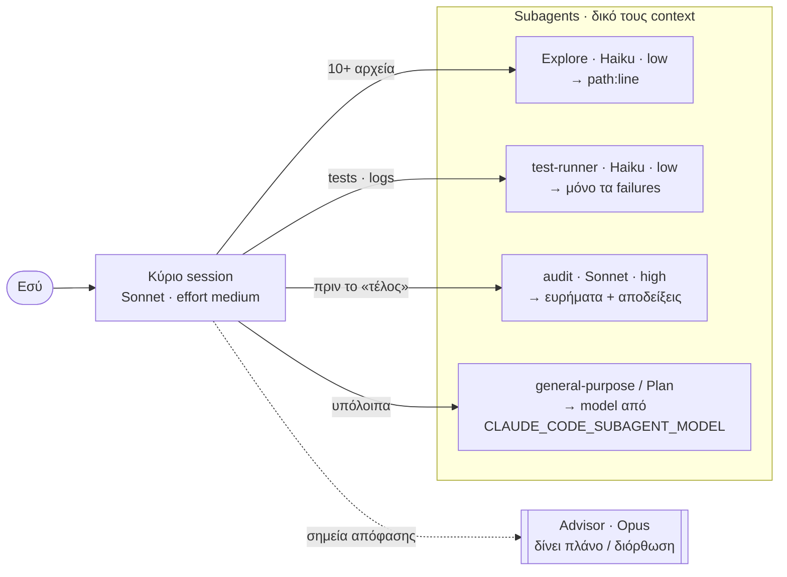
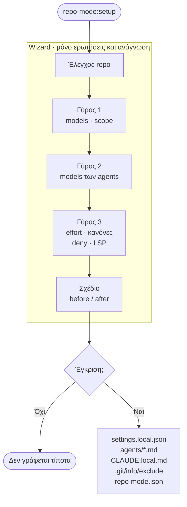

# repo-mode

Οδηγός (wizard) για Claude Code που ρυθμίζει **ανά repository** ποιο model κάνει ποια δουλειά: το κύριο model και το effort του, τον advisor, βοηθητικούς subagents με φθηνότερα models, κανόνες ανάθεσης, Read deny rules και code-intelligence plugin. Δεν γράφει τίποτα πριν εγκρίνεις ολόκληρο το σχέδιο, και το `/repo-mode:off` αναιρεί ακριβώς ό,τι έγραψε.

## Γιατί αξίζει

Χωρίς ρυθμίσεις, το Claude Code τρέχει σχεδόν όλη τη δουλειά στο ίδιο (συνήθως το ακριβότερο) model. Το repo-mode μοιράζει τη δουλειά με βάση τα docs και τις οδηγίες της Anthropic:

| Χωρίς repo-mode | Με repo-mode | Όφελος |
|---|---|---|
| Ο ενσωματωμένος **Explore** τρέχει σε **Opus** όταν έχεις συνδρομή ή Console account. | Ένας agent `Explore` του repo τον αντικαθιστά, σε **Haiku**, με `effort: low`. | Η αναζήτηση στον κώδικα είναι η πιο συχνή δουλειά subagent. Το Haiku 5.5 κοστίζει $0.10 / $0.50 ανά εκατομμύριο tokens (input / output) μέχρι τα 100K tokens prompt. Το `autoCompactWindow: 100000` τον κρατά κάτω από αυτό το όριο. |
| Οι **general-purpose** και **Plan** παίρνουν το model του κύριου session. Με κύριο Opus, τρέχουν κι αυτοί σε Opus. | Το `CLAUDE_CODE_SUBAGENT_MODEL` (π.χ. `sonnet`) μπαίνει μόνο σε αυτό το repo. | Οι υπόλοιποι subagents φεύγουν από το ακριβό model, χωρίς να αλλάζει το κύριο session. |
| Ένα model κάνει και τον σχεδιασμό και την εκτέλεση. | Κύριο Sonnet (ή Haiku) με **Opus advisor**, ή `opusplan`. | Ο advisor διαβάζει τη συζήτηση μόνο στα σημεία απόφασης. Στο blog της Anthropic, Sonnet με Opus advisor έδωσε +2.7 μονάδες στο SWE-bench Multilingual με 11.9% χαμηλότερο κόστος ανά task, και Haiku με Opus advisor 41.2% αντί για 19.7% στο BrowseComp (μετρήσεις με παλαιότερα models). |
| Ένας subagent σε άλλο model από το κύριο δεν παίρνει το effort του session. | Κάθε template ορίζει `effort`: `low` για αναζήτηση και tests, `high` για review. | Λιγότερο «σκέψιμο» στις μηχανικές δουλειές, περισσότερο στο review. |
| Τα πλήρη tests και τα logs γεμίζουν το κύριο context. | Ο **test-runner** επιστρέφει μόνο τα failures, αυτολεξεί. | Ο θόρυβος μένει έξω. Στο κύριο session φτάνει μόνο η σύνοψη. |
| Το review το κάνει το ίδιο session που έγραψε τον κώδικα. | Ο **audit** κάνει ανεξάρτητο review του diff, χωρίς το ιστορικό της συζήτησης και χωρίς σχόλια για στυλ. | Ένας «φρέσκος» reviewer δεν έχει δει το σκεπτικό του κώδικα, άρα δεν επηρεάζεται από αυτό. |
| Το Claude μαντεύει πότε να αναθέσει. | Τέσσερις σύντομοι κανόνες στο `CLAUDE.local.md`. | Ανάθεση μόνο όταν συμφέρει. Η Anthropic εκτιμά ότι τα συστήματα με πολλούς agents καίνε 3–10× περισσότερα tokens, άρα η ανάθεση έχει νόημα μόνο για 10+ αρχεία, 3+ ανεξάρτητα κομμάτια, ή ανεξάρτητο έλεγχο. |
| Vendored ή generated κώδικας μπαίνει στις αναζητήσεις. | Read deny rules μόνο για tracked φακέλους, όπως `vendor/` και `dist/`. | Λιγότερα άχρηστα αρχεία στο context. |

Για να δεις πού πάνε τα tokens, το `/usage` δείχνει την κατανάλωση ανά subagent.

## Πώς μοιράζεται η δουλειά



Κάθε subagent ξεκινά με δικό του, καθαρό context, χωρίς CLAUDE.md (`omitClaudeMd: true`) και χωρίς το Agent tool, άρα δεν ξεκινά δικούς του subagents. Στο κύριο session επιστρέφει μόνο το τελικό του μήνυμα. Οι subagents δεν δίνουν «εξυπνότερη» απάντηση από το κύριο session. Βοηθούν σε τρία πράγματα: παράλληλη δουλειά, θόρυβο έξω από το context, ανεξάρτητο έλεγχο.

## Πώς δημιουργούνται οι ρυθμίσεις



Στην έγκριση μπορείς και να αλλάξεις απαντήσεις: ο wizard γυρίζει στον Γύρο 1. Μη επιτρεπτός συνδυασμός model/advisor ξαναρωτιέται στον ίδιο γύρο. Στο scope «Όλη η ομάδα» τα αρχεία είναι `.claude/settings.json` και `CLAUDE.md`, για commit.

## Εγκατάσταση (μία φορά)

```bash
claude plugin marketplace add kniko/claude-plugins
claude plugin install repo-mode@kniko-tools
```

Ενημέρωση σε νεότερη έκδοση: `claude plugin marketplace update kniko-tools`.

Το plugin μπαίνει σε user scope, άρα οι εντολές είναι διαθέσιμες σε κάθε repo. Από μόνο του δεν αλλάζει τίποτα σε κανένα repo: τις αλλαγές τις κάνει μόνο το `/repo-mode:setup`, και μόνο στο repo όπου το τρέχεις.

## Εντολές

| Εντολή | Τι κάνει |
|---|---|
| `/repo-mode:setup` | Ρωτάει main model, advisor, subagents, scope, models των subagents, model για τους υπόλοιπους subagents, effort, κανόνες, deny rules και LSP. Δείχνει όλες τις αλλαγές (before/after) και εφαρμόζει μόνο μετά την έγκρισή σου. |
| `/repo-mode:status` | Μόνο ανάγνωση: τι ισχύει τώρα σε αυτό το repo και από ποιο αρχείο προέρχεται. Επισημαίνει και ακριβές ρυθμίσεις, π.χ. subagents που τρέχουν σε Opus. |
| `/repo-mode:off` | Αναιρεί ακριβώς ό,τι έγραψε το setup (από το `.claude/repo-mode.json`), επαναφέρει τις προηγούμενες τιμές, και ζητάει έγκριση πριν σβήσει οτιδήποτε. |

Μετά από `setup` ή `off`, ξεκίνα νέο session στο repo.

## Προτεινόμενες επιλογές

| Ερώτηση | Πρόταση | Εναλλακτικές |
|---|---|---|
| Κύριο model | Sonnet | Opus · `opusplan` (Opus στο plan mode, Sonnet στην εκτέλεση) · Haiku (το φθηνότερο, καλό με Opus advisor) |
| Advisor | Opus | Fable · Sonnet (όχι με κύριο Opus) · κανένας |
| Explore / test-runner | Haiku | Sonnet · ίδιο με το κύριο |
| audit | Sonnet | Opus · ίδιο με το κύριο |
| Υπόλοιποι subagents | Sonnet αν το κύριο είναι Opus, `opusplan` ή Fable. Αλλιώς ίδιο με το κύριο. | Haiku |
| Effort | default του model (`medium`) | `high` / `xhigh` για δύσκολη δουλειά, `low` για ρουτίνα |

## Τι γράφει σε κάθε repo

**Scope «Μόνο εγώ» (προεπιλογή)**: τίποτα δεν πάει σε commit.
- `.claude/settings.local.json`: `model`, `advisorModel`, `effortLevel`, `env.CLAUDE_CODE_SUBAGENT_MODEL`, `permissions.deny`
- `.claude/agents/Explore.md`, `test-runner.md`, `audit.md` (όσα επιλέξεις)
- `CLAUDE.local.md`: block με κανόνες ανάθεσης, ανάμεσα σε `<!-- repo-mode:start/end -->`
- `.claude/repo-mode.json`: τι άλλαξε, για να γίνει σωστά το undo
- `.git/info/exclude`: όλα τα παραπάνω, ώστε να μη φαίνονται στο `git status` (το `.gitignore` του repo δεν αλλάζει)

**Scope «Όλη η ομάδα»**: τα ίδια, αλλά σε `.claude/settings.json` και `CLAUDE.md`, για commit.

## Σημειώσεις

- Ο advisor είναι experimental και δουλεύει μόνο μέσω Anthropic API, όχι Bedrock, Vertex ή Foundry. Δεν λειτουργεί αν έχει οριστεί `DISABLE_TELEMETRY`. Κάθε κλήση του ξαναδιαβάζει όλη τη συζήτηση, χωρίς cache, με τις τιμές του advisor model. Αξίζει σε μεγάλες δουλειές πολλών βημάτων, όχι σε μικρές.
- Μην αλλάζεις advisor από τον picker του `/advisor`: σώζει στις global ρυθμίσεις και ισχύει σε όλα τα repos.
- Ο `audit` κάνει παρόμοια δουλειά με το ενσωματωμένο `/code-review`. Ο `audit` τρέχει αυτόματα πριν το «τελείωσα», ενώ το `/code-review` το τρέχεις όποτε θες.
- Ο agent `audit` δεν τρέχει σε worktree: ένα worktree ξεκινά από το default branch, χωρίς τις uncommitted αλλαγές σου, άρα δεν θα έβλεπε το diff.
- Οι `audit` και `test-runner` έχουν Bash. Το ότι δεν αλλάζουν αρχεία το λένε οι οδηγίες τους, δεν το επιβάλλει το Claude Code. Ο `Explore` είναι τεχνικά read-only (μόνο Read, Grep, Glob).
- Ελάχιστες εκδόσεις Claude Code: `autoCompactWindow` v2.1.296+, Haiku 5.5 v2.1.293+, Sonnet 5.5 v2.1.284+, Opus 5.5 v2.1.280+, `omitClaudeMd` v2.1.271+. Οι παλαιότερες εκδόσεις απλώς αγνοούν τα πεδία που δεν ξέρουν.

## Πηγές

- [Create custom subagents](https://code.claude.com/docs/en/sub-agents)
- [Advisor](https://code.claude.com/docs/en/advisor)
- [Model configuration](https://code.claude.com/docs/en/model-config)
- [Manage costs](https://code.claude.com/docs/en/costs)
- [Best practices](https://code.claude.com/docs/en/best-practices)
- [Pricing](https://platform.claude.com/docs/en/about-claude/pricing)
- [How and when to use subagents in Claude Code](https://claude.com/resources/articles/subagents-in-claude-code)
- [Steering Claude Code](https://claude.com/resources/articles/steering-claude-code-skills-hooks-rules-subagents-and-more)
- [The advisor strategy](https://claude.com/blog/the-advisor-strategy)
- [When to use multi-agent systems](https://claude.com/blog/building-multi-agent-systems-when-and-how-to-use-them)

Στοιχεία ελεγμένα στις 2026-11-08.
